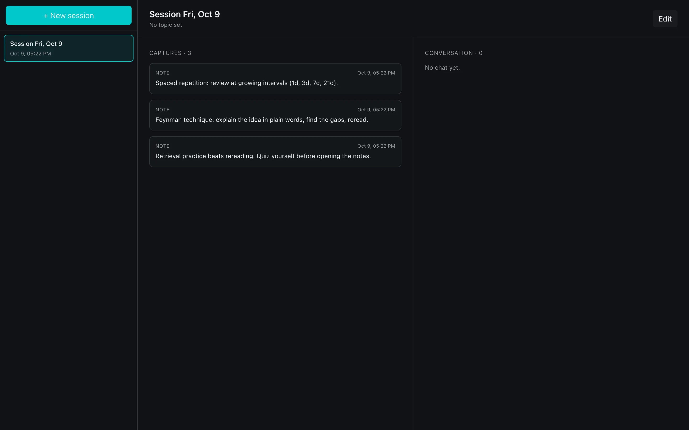

# Learning Assistant

**Problem.** Learning material arrives as screenshots, voice notes, files and chat, and an AI chat cannot help with material it never saw.

**Idea.** One always-on-top macOS panel (toggled with ⌘⇧L) captures all four into local learning sessions, and the chat with Claude reads the active session's captures as context.

**Built.** A Tauri 2 floating panel plus a Next.js 16 main window, with chats and captures kept in local SQLite and files on disk. This is v1 and runs in dev mode only; production bundling is deferred. 10 commits on 5 days, Apr 25 to Oct 25, 2026.

**Decision.** Every AI call goes through the Vercel AI Gateway with plain `provider/model` strings, and the `@ai-sdk/anthropic` and `@ai-sdk/openai` packages are never imported. The Gateway gives one API key, observability and fallbacks.

A macOS desktop Learning Assistant: an always-visible floating panel + companion web UI that captures screenshots, voice notes, files, and chat conversations into local learning sessions, powered by Claude (via the Vercel AI Gateway).

This is **v1**: floating-panel + chat + manual capture. Continuous screen recording (ScreenPipe), auto learning-node extraction, and plan generation are deferred to v2.



The main window (`/main`) with demo notes, run with `pnpm dev:web` against a throwaway data directory.

## Features (v1)

- **Floating panel** — borderless, always-on-top, visible across Spaces and over fullscreen apps. Toggle with `⌘⇧L`.
- **Three tabs** — Capture, Chat, Sessions.
  - Capture: take a screenshot (interactive macOS selection), record a voice note (auto-transcribed via Whisper), drop files, or type a quick note.
  - Chat: streaming chat with Claude that sees the active session's captures as context.
  - Sessions: browse recent sessions, jump into the full-size **main window** for review.
- **Local-first** — everything (chat, captures, files) lives in `~/Library/Application Support/LearningAssistant/`. No cloud DB.
- **One env var** - `AI_GATEWAY_API_KEY` and you're done. `AI_CHAT_MODEL` and `AI_TRANSCRIBE_MODEL` optionally override the defaults (`anthropic/claude-sonnet-4-6`, `openai/whisper-1`); see `apps/web/.env.example`.

## Stack

- **Desktop shell** — [Tauri 2.x](https://tauri.app) (Rust core + macOS-specific NSPanel-style window tweaks).
- **UI** — [Next.js 16](https://nextjs.org) App Router (React 19), one codebase serving both the panel (`/panel`) and main window (`/main`).
- **AI** — Claude Sonnet 4.6 via [Vercel AI Gateway](https://vercel.com/docs/ai-gateway), [AI SDK v6](https://ai-sdk.dev). Implicit gateway routing through `"anthropic/claude-sonnet-4-6"` model strings.
- **Voice** — OpenAI Whisper via the same Gateway.
- **Storage** — local SQLite (`better-sqlite3` + Drizzle), files on disk in app-data dir.

## Repo layout

```
apps/
  desktop/         # Tauri 2.x shell (Rust)
    src-tauri/
      src/
        lib.rs           # app setup, hotkey, screenshot, window mgmt
        panel_macos.rs   # NSPanel-style level + collection-behavior
      capabilities/      # Tauri 2 permission allowlist
      icons/             # generated placeholder icons
      tauri.conf.json
      Cargo.toml
  web/             # Next.js 16 App Router
    app/
      panel/page.tsx       # floating-panel UI
      main/page.tsx        # full-window UI
      api/chat/route.ts    # streaming chat (AI SDK v6)
      api/transcribe/route.ts  # Whisper transcription
    components/
    lib/
      schema.ts            # Drizzle schema
      db.ts                # better-sqlite3 + auto-migrate on first use
      queries.ts           # CRUD + session helpers
      actions.ts           # server actions for capture / session ops
      paths.ts             # resolves app-data dir from LA_DATA_DIR
      ai.ts                # model identifiers + system prompt builder
    drizzle/                  # generated SQL migrations
    scripts/migrate.ts        # standalone migration runner
```

## Prerequisites

- macOS 13+ (NSPanel-style panel is macOS-only for v1)
- Node.js 24+
- pnpm 10+
- Rust (stable) — `curl --proto '=https' --tlsv1.2 -sSf https://sh.rustup.rs | sh -s -- -y`
- Xcode Command Line Tools (`xcode-select --install`)

## Setup

```bash
pnpm install
cp apps/web/.env.example apps/web/.env
# fill in AI_GATEWAY_API_KEY  (https://vercel.com/dashboard → AI Gateway → API Keys)

pnpm db:generate   # generate Drizzle SQL migrations (already committed)
pnpm db:migrate    # apply to ~/Library/Application Support/LearningAssistant/db.sqlite
```

> The `.env` file lives inside `apps/web/` — that's where Next.js loads it from. Putting it at the workspace root won't work.

## Development

```bash
pnpm dev
```

Tauri's `beforeDevCommand` boots the Next.js dev server on `localhost:3000`, then opens the floating panel pointing at `/panel`.

- Toggle panel: **⌘⇧L** (or click "Open main" inside the Sessions tab to spawn the full-size window).
- The dev panel is borderless; drag the header bar to move it. macOS will ask for **microphone** permission the first time you record voice, and **screen recording** permission the first time you take a screenshot.

If you only want the web UI (no Tauri shell):

```bash
pnpm dev:web
# then open http://localhost:3000/main or http://localhost:3000/panel
# (the root path / redirects to /main)
```

## How the pieces talk

```
┌──────────────────────────────────────────────────────────┐
│  Tauri (Rust)                                            │
│   • spawns Next.js dev server (or sidecar in prod)       │
│   • passes LA_DATA_DIR env var so SQLite lives in        │
│     ~/Library/Application Support/LearningAssistant/     │
│   • exposes Rust commands:                               │
│       capture_screenshot()  → writes PNG, returns path   │
│       open_main_window(id)  → opens/focuses main window  │
│       toggle_panel()        → show/hide floating panel   │
│   • registers the ⌘⇧L global shortcut                    │
│   • applies NSPanel-style level + collection behavior    │
└──────────────────────────────────────────────────────────┘
                          │
              http://localhost:3000
                          │
┌──────────────────────────────────────────────────────────┐
│  Next.js 16 (Node)                                       │
│   • /panel    → floating-panel UI (CaptureTab,           │
│                 ChatTab, SessionsTab)                    │
│   • /main     → full-window sessions browser             │
│   • /api/chat → streamText() via AI SDK v6 →             │
│                 Vercel AI Gateway → Claude Sonnet 4.6    │
│   • /api/transcribe → experimental_transcribe() →        │
│                 Vercel AI Gateway → openai/whisper-1     │
│   • Server Actions for save-note, save-screenshot-path,  │
│                 save-dropped-file, new-session, …        │
└──────────────────────────────────────────────────────────┘
                          │
                  better-sqlite3
                          │
   ~/Library/Application Support/LearningAssistant/
       db.sqlite        ← chats + captures + sessions metadata
       captures/        ← audio (.webm), screenshots (.png), files
```

## Production builds (deferred)

`pnpm build` is wired but production bundling is a v1+ polish item: `output: 'standalone'` produces a Node server that needs a bundled Node binary as a Tauri sidecar. We chose to leave that for a follow-up so v1 can converge on the dev-mode UX.

For now, treat `pnpm dev` as the supported way to run the app.

## Verification checklist

After `pnpm install && pnpm db:migrate && pnpm dev`:

- [ ] Floating panel appears on launch.
- [ ] `⌘⇧L` toggles panel visibility.
- [ ] **Capture tab** → "Screenshot" → macOS crosshair → drag a region → row appears in panel and PNG is in `~/Library/Application Support/LearningAssistant/captures/`.
- [ ] **Capture tab** → "Record voice" → speak → Stop → transcript appears in the row within ~5s.
- [ ] **Capture tab** → drop a PDF onto the panel → row appears.
- [ ] **Capture tab** → quick-note input → Enter → row appears.
- [ ] **Chat tab** → type a question → streaming reply that references your captures.
- [ ] **Sessions tab** → "Open main" → main window opens with sidebar of sessions, captures grid, and conversation pane.

## Roadmap (v2+)

- ScreenPipe integration → continuous screen + audio capture
- Auto learning-node extraction from capture streams
- Learning plan generator (topic → ordered tasks)
- Obsidian export / plugin
- Multi-device sync (would mean swapping local SQLite for Postgres + auth)
- Code signing & notarization for distribution

## License

MIT
